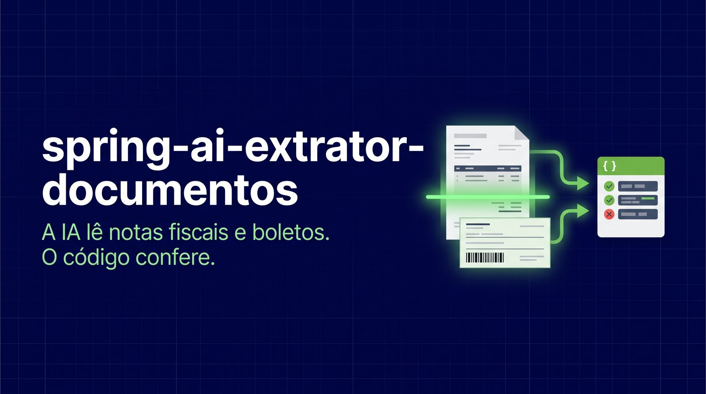
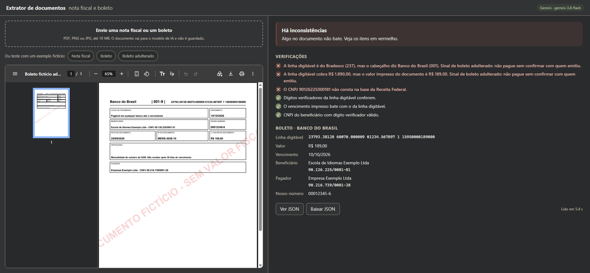

# spring-ai-extrator-documentos



[](https://github.com/ronnyarruda20/spring-ai-extrator-documentos/actions/workflows/ci.yml)


Você envia uma **nota fiscal (DANFE)** ou um **boleto** em PDF ou imagem e recebe os dados em JSON, já conferidos. Um modelo multimodal lê o documento direto, sem OCR à parte. Depois, **regras no código** conferem cada número que ele leu, e o CNPJ é consultado na Receita pelo [spring-ai-mcp-brasil](https://github.com/ronnyarruda20/spring-ai-mcp-brasil).

O modelo lê; o código decide se dá para confiar.



## O golpe do boleto adulterado

O golpista intercepta um boleto verdadeiro e troca só a linha digitável por uma dele. O logotipo, o beneficiário e o valor impresso continuam os originais, e a pessoa paga sem desconfiar.

Mas a linha digitável carrega o banco, o valor e o vencimento. O extrator decodifica esses três e compara com o que está impresso:

```
✕ A linha digitável é do Bradesco (237), mas o cabeçalho diz Banco do Brasil (001).
  Sinal de boleto adulterado: não pague sem confirmar com quem emitiu.
✕ A linha digitável cobra R$ 1.890,00, mas o valor impresso do documento é R$ 189,00.
  Sinal de boleto adulterado: não pague sem confirmar com quem emitiu.
```

A linha adulterada tem dígitos verificadores **válidos**. O golpista gera uma linha correta, então checar só os dígitos não basta; é a comparação com o impresso que pega o golpe.

## O que é conferido

**Nota fiscal**
- Dígito verificador da chave de acesso (44 dígitos, módulo 11).
- CNPJ do emitente, número, modelo e mês de emissão **embutidos na chave**, comparados com os campos impressos.
- Dígitos do CNPJ e do CPF, inclusive o CNPJ alfanumérico que a Receita emite desde julho de 2026.
- Quantidade vezes valor unitário de cada item, soma dos itens e o total (produtos + frete − desconto).
- CNPJ do emitente na Receita: se existe, se está ativo e se o nome bate.

**Boleto**
- Dígitos dos três campos (módulo 10) e o dígito geral do código de barras (módulo 11) da linha digitável.
- Banco, valor e vencimento decodificados da linha, comparados com o impresso. O vencimento considera o **recomeço do fator em 22/02/2025**, quando a contagem de 1997 chegou a 9999.
- CNPJ do beneficiário: dígito e cadastro na Receita.

Cada verificação volta como `OK`, `ALERTA` ou `ERRO`, e o resultado geral é `CONFERIDO`, `REVISAR` ou `INCONSISTENTE`.

## Decisões de implementação

- **O modelo é instruído a não corrigir nada.** Se o total impresso está errado, ele copia o errado; a conferência é das regras. Um modelo que "arruma" os números esconderia justamente o que interessa.
- **Esquema com descrições por campo.** O [`Extracao`](backend/src/main/java/io/github/ronnyarruda20/extrator/extracao/Extracao.java) usa `@JsonPropertyDescription`, que o Spring AI transforma em esquema JSON para o modelo. Cada campo diz o formato esperado, como "só os dígitos, sem pontuação".
- **Regras sem IA e sem rede.** [`Digitos`](backend/src/main/java/io/github/ronnyarruda20/extrator/validacao/Digitos.java), [`LinhaDigitavel`](backend/src/main/java/io/github/ronnyarruda20/extrator/validacao/LinhaDigitavel.java) e [`ChaveNfe`](backend/src/main/java/io/github/ronnyarruda20/extrator/validacao/ChaveNfe.java) são aritmética pura, testada com os valores dos exemplos.
- **Receita pelo protocolo MCP.** O CNPJ é consultado na ferramenta `consultar_cnpj` do spring-ai-mcp-brasil. Se o servidor cair, a verificação vira alerta, não falha.

## Os exemplos

[`exemplos/`](exemplos/) tem uma nota fiscal, um boleto e um boleto adulterado, todos **fictícios** e marcados como "sem valor fiscal". Eles são gerados por [`gerar_exemplos.py`](exemplos/gerar_exemplos.py), que calcula de verdade os dígitos da chave e da linha digitável.

Os CNPJs têm dígito válido, mas foram conferidos na BrasilAPI antes do uso e **não pertencem a nenhuma empresa**. Por isso o extrator acusa, corretamente, que eles não constam na Receita. Numa nota fiscal falsa, é exatamente esse o aviso que se quer.

## Como rodar

Requer Docker e uma chave da API do Gemini ([Google AI Studio](https://aistudio.google.com/apikey)).

```bash
export GEMINI_API_KEY=sua-chave
docker compose up --build
```

Abra <http://localhost:8080> e clique num dos exemplos, ou envie um documento seu. O compose sobe também o servidor MCP Brasil, construído do repositório dele.

**Com Claude:** `export ANTHROPIC_API_KEY=sua-chave CHAT_PROVIDER=anthropic` antes do `docker compose`.

**Pela API:**

```bash
curl -F arquivo=@exemplos/boleto-adulterado.pdf localhost:8080/api/extracoes
```

### Desenvolvimento

```bash
cd backend && mvn spring-boot:run              # API em :8080 (Java 21)
cd frontend && npm install && npx ng serve     # interface em :4200, com proxy para a API
```

Para conferir CNPJs em desenvolvimento, rode o spring-ai-mcp-brasil na porta 8090, ou defina `MCP_BRASIL_URL`.

## Testes

```bash
cd backend && mvn verify          # 23 testes
cd frontend && npx ng test        # 6 testes
```

- **Regras:** dígitos, chave, linha digitável (inclusive o fator de vencimento de 2025), coerência entre chave e campos, somas, e o boleto adulterado com linha válida.
- **Integração:** a API recebe o PDF de exemplo, manda ao modelo como mídia `application/pdf` (conferido no teste) e interpreta a saída estruturada. Os testes usam um modelo falso e uma Receita falsa, sem chamar API paga.
- **CI:** roda as duas suítes e sobe o compose, conferindo a interface, os exemplos e a API.

## Limitações

- O layout de DANFE e de boleto varia muito; os exemplos são simplificados. Documentos reais funcionam, mas não há garantia para todos os modelos.
- Não lê o XML da NF-e, que seria a fonte mais confiável quando disponível.
- O documento é enviado ao provedor de IA. Não use com dados sensíveis sem avaliar a política do provedor.

## Stack

Java 21 · Spring Boot 4.0 · Spring AI 2.0 (multimodal, saída estruturada) · MCP Java SDK (cliente) · Gemini e Claude · Angular 21 · Vitest · GitHub Actions · Docker

## Licença

[MIT](LICENSE)
